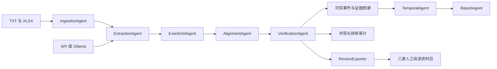

# 多模态知识组织与决策生成 Agent

面向当前初赛数据的可运行基线：读取开源军情 TXT、网上舆论 TXT、雷达 XLSX，完成事实抽取、跨源关联、逐字段核验、知识图谱组织、时序分析和日报输出。代码、配置、脚本、日报与审计结果放在 `Code` 内；方便人工阅读的资料另存到项目根目录的 `Datas_分组_新版`，原始 `Datas` 和 `Docs` 保留原样。

当前默认采用新闻主组与整体一一对应：每篇新闻固定一个主组，最多配一篇舆论和各平台对应的雷达批次。证据不足时不强行凑齐三类来源；新闻与舆论，或新闻与雷达的两源事件都可以核验。阅读副本在 `../Datas_分组_新版/`，默认分析目录为 `outputs/one_to_one_trial/`。

当前已重算 `2025-05-01`，结果在 `outputs/one_to_one_20250501_local/`：50个新闻主组，可信事件35、可疑事件15、未配对记录0，覆盖52批/600条雷达和100篇原文，无重复归属或遗漏。本次复用100条真实本地模型抽取缓存，无规则回退；114项测试通过。

目录只分为 **可信事件、可疑事件、未配对记录**。9个可信事件在核心海域之外，所以当天日报接纳26项；可信与日报范围分别判断。旧版分析保留用于对照；备选对应保存到主组的 `对应候选.csv`，不另计主组。

这里采用共享结构化状态的多角色 Agent 工作流。模型负责有证据约束的抽取，算法负责关联及核验；日报由已核验事实生成。无需配置模型也可以执行完整规则基线。

## 先用本地模型跑一天

本节命令在**项目根目录**（即包含 `Code`、`Datas`、`Docs` 的目录）执行。当前电脑已经创建了专属 Conda 环境 `multimodal-agent`，Ollama 模型配置为 `qwen3.5:9b-q8_0`。

打开 Ollama，然后执行：

```powershell
.\Code\scripts\run.cmd --date 2025-05-01 --single-day --use-llm --strict-llm --max-llm-calls 324 --force --output-dir Code\outputs\one_to_one_20250501_local --review-dir Datas_分组_新版

# 生成重分组效果说明，并核对全部阅读副本（不再次调用模型）
& D:\APP\miniconda\envs\multimodal-agent\python.exe .\Code\scripts\validate_one_to_one.py --analysis-dir Code\outputs\one_to_one_20250501_local --date 2025-05-01 --reference Code\outputs\structure_audit\2025-05-01_新闻舆论雷达对应核对.csv
```

处理顺序：读取材料 → 模型或规则抽取 → 地点/型号归一化 → 保存SQLite证据库 → 检索当天证据 → 整体一一匹配新闻与舆论 → 按平台槽位分配雷达 → 逐字段核验 → 日报和阅读副本。联合活动在组内按平台核验，不另拆主组。

**看结果的顺序：**

1. [结构验证](outputs/one_to_one_20250501_local/structure_validation.json)：主组数、唯一归属、原文副本与原始雷达逐行核对。
2. [阅读导航](../Datas_分组_新版/README.md) 或 [索引.csv](../Datas_分组_新版/索引.csv)：选择事件。
3. 每组 `README.md` 简述关联依据；`关联说明.md` 提供完整字段对照，再并排阅读新闻、舆论、雷达。
4. [当天日报](outputs/one_to_one_20250501_local/reports/2025-05-01.md)：查看通过核验后进入核心海域日报的事实。

旧版多组合修复记录保存在 `outputs/constraints_trial/`；以下是历史对照命令，不用于新版主组结构验证：

```powershell
& D:\APP\miniconda\envs\multimodal-agent\python.exe .\Code\scripts\summarize_regroup.py --date 2025-05-10 --validate --compare-to Code\outputs\constraints_trial\before_bugfix_2026-10-06
```

| 参数 | 本次用途 | 省略时的行为 |
| --- | --- | --- |
| `--date` | 指定日期，格式为 `YYYY-MM-DD` | 可改用 `--nodes` 或 `--all` |
| `--single-day` | 只处理指定日期的材料 | 使用 `report.lookback_days`，默认是截至当天共 7 天 |
| `--use-llm` | 启用 Ollama/API 抽取 | 使用配置中的 `llm.enabled`，当前为 `false` |
| `--strict-llm` | 任何模型错误立即停止 | 允许规则回退，并在结果中记录回退数量 |
| `--output-dir` | 保存一份独立试跑结果 | 输出到 `paths.output_dir`；阅读分组到 `paths.review_dir` |
| `--review-dir` | 另行指定人工阅读资料目录 | 指定 `--output-dir` 后自动用其 `review/` 子目录 |
| `--force` | 重算关联与核验 | 复用有效的日缓存；加此参数仍会复用相同模型请求缓存 |

指定 `--output-dir` 或 `--review-dir` 的相对路径以**当前工作目录**为基准。`config.toml` 内的相对路径以**配置文件所在目录**为基准。只选 `--date` 并不表示只处理一天，单日试跑请同时加 `--single-day`。

初次无缓存时单日通常发起 100 个模型请求，重试可能增加次数。复跑可复用结果，查看 `manifest.json` 中的 `llm_requests`、`llm_cache_hits`、`llm_fallbacks` 区分真实请求、请求缓存和回退。如果整天命中日缓存，请求数为 0；当天保存的抽取元数据和 trace 仍可查看。

首次真实模型请求记录在 `outputs/ollama_trial/inference_run.json`。当前 `outputs/one_to_one_trial/manifest.json` 记录请求计数；逐字段模型声明及引文保存在日结果中。`validate_one_to_one.py` 验证当前主组；两个旧版summarize脚本只用于历史试跑。

若要比较规则结果：

```powershell
.\Code\scripts\run.cmd --date 2025-05-10 --single-day --offline --output-dir Code\outputs\rules_trial
```

只处理一天时，日报的历史窗口也是一天，不能据此判断跨日趋势。换日期建议换输出目录，如 `Code\outputs\trial_2025-05-18`。

## 环境安装与常用运行

已创建的专属 Conda 环境：`multimodal-agent`，Python 3.11。当前电脑的 Conda 位于 `D:\APP\miniconda`。

在项目根目录运行：

```powershell
# 默认输出赛题指定的 8 个研判节点日报
.\Code\scripts\run.cmd --offline

# 只处理一天；输出包含当天的日报和人工阅读分组
.\Code\scripts\run.cmd --date 2025-05-10 --single-day --offline

# 全量 80 天，生成每日结果和日报
.\Code\scripts\run.cmd --all --offline
```

CMD 入口通过 Conda 的绝对路径调用环境，不依赖 `conda init`，也不受当前 PowerShell 的 `.ps1` 执行限制影响。如 Conda 位置不同，在 PowerShell 设置 `$env:FUSION_CONDA_EXE = "实际 conda.exe 路径"`。指定其他配置可设置 `$env:FUSION_CONFIG`。同时保留 `run.ps1`，供已允许脚本执行的终端使用，它支持 `-CondaPath` 参数。

需要重建环境时：

```powershell
powershell -NoProfile -ExecutionPolicy Bypass -File .\Code\scripts\bootstrap.ps1 -CondaPath D:\APP\miniconda\Scripts\conda.exe
```

该命令只在启动的脚本进程中指定执行策略，不改系统策略。脚本使用 `conda-forge` 建立隔离环境，并安装本项目。也可以在已可使用 `conda` 的终端中执行：

```powershell
cd Code
conda env create -f environment.yml
conda activate multimodal-agent
python -m fusion_agent doctor
python -m fusion_agent inspect
python -m fusion_agent run --nodes --offline
```

## 单一配置文件

所有参数集中在 `config.toml`：数据路径、输出路径、模型服务、预算、并发、关联时间窗口、核验容差、历史窗口、研判日期。相对路径始终按配置文件所在目录解析，因此从其他工作目录启动也不会改变数据位置。

默认 `llm.enabled = false`，这是无需模型的基线。接入模型后，设置为 `true` 或运行时加 `--use-llm`。规则基线可以用 `--offline` 强制开启。

`extraction.mode = "rules"` 只运行规则；`hybrid` 和当前的 `llm` 模式都会合并规则与模型引用校验结果，保留规则发现的冲突。模型无法直接裁决事件真伪，也不会直接生成开放式研判内容。

### Ollama

先确保 Ollama 服务已启动且安装了拟使用的模型。把 `ollama list` 中的完整模型名称写入配置：

```toml
[llm]
enabled = true
provider = "ollama"

[llm.ollama]
base_url = "http://localhost:11434"
model = "qwen3.5:9b-q8_0"
keep_alive = "10m"
num_ctx = 8192
think = false
num_predict = 2048
```

本机 `model` 已填写为 `qwen3.5:9b-q8_0`，不用重新下载。`think = false` 请求关闭思考输出，用于这次事实抽取试跑；需要时可改为 `true`。`concurrency = 1` 让本地模型逐篇处理。保留原配置里的其他参数。连接测试命令在项目根目录执行：

```powershell
& D:\APP\miniconda\Scripts\conda.exe run --no-capture-output -n multimodal-agent python -m fusion_agent doctor --check-llm
.\Code\scripts\run.cmd --date 2025-05-10 --single-day --use-llm --strict-llm
```

连接采用 [Ollama 官方 `/api/chat` 接口](https://docs.ollama.com/api/chat)，关闭流式输出并传入结构化 JSON schema；`think` 控制模型思考输出。`num_predict` 限制单篇输出长度；输出被截断而无法解析 JSON 时会视为调用错误。

### LLM API

支持实现 `POST /chat/completions` 协议的模型服务。配置的 `base_url` 应包含服务商要求的版本前缀，例如 `/v1`；代码追加 `/chat/completions`。

```toml
[llm]
enabled = true
provider = "api"

[llm.api]
base_url = "https://你的服务商地址/v1"
model = "服务商提供的模型名"
api_key = ""
api_key_env = "LLM_API_KEY"
json_mode = true
```

```powershell
$env:LLM_API_KEY = "你的密钥"
.\Code\scripts\run.cmd --date 2025-05-10 --single-day --use-llm --strict-llm --output-dir Code\outputs\api_trial
```

也可以直接在 `api_key` 中配置密钥；环境变量便于避免把密钥写入版本控制。若服务商不支持 `response_format`，将 `json_mode` 改为 `false`。不支持此协议的服务商可在 `llm.py` 添加适配器，其余 Agent 不需要修改。

调用有超时、可重试错误的指数退避、HTTP 请求预算和本地缓存。`max_calls` 统计实际 HTTP 请求，包含重试；默认每次运行最多 200 个请求。全量数据有 8,000 篇文本，启用模型时请根据费用和运行时间调整该预算。预算耗尽或模型故障时，默认记录 `llm_fallback` 并运行规则抽取；设置 `fail_on_error = true` 可以让运行立即失败。回退结果不会被存成成功的模型日缓存。

### 配置中最常改的项目

| 配置项 | 用途 | 当前设置 |
| --- | --- | --- |
| `llm.provider` | 使用本地模型还是兼容 API | `ollama` |
| `llm.ollama.model` | 必须与本地模型完整名称一致 | `qwen3.5:9b-q8_0` |
| `llm.enabled` | 是否默认启用模型 | `false`，试跑命令用 `--use-llm` 开启 |
| `llm.concurrency` | 同时抽取多少篇文本 | `1`，适合本地单模型 |
| `llm.max_calls` | 一次运行最多实际 HTTP 请求数，含重试 | `200`，适合单日试跑 |
| `llm.timeout_seconds` | 每个模型请求的超时 | `300` 秒 |
| `llm.fail_on_error` | 模型失败是否终止 | `false`；试跑用 `--strict-llm` 覆盖 |
| `alignment.candidate_gap_hours` | 活动区间相隔几小时仍保留候选，不自动确认 | `3` 小时 |
| `alignment.overlap_slack_minutes` | 区间接壤容差，有身份依据时才用于确认 | `15` 分钟 |
| `verification.time_tolerance_minutes` | 日报中精确起止边界的跨源支持容差 | `5` 分钟；与活动区间关联窗口不同 |
| `report.lookback_days` | 日报历史窗口含当天的总天数 | `7`；单日试跑覆盖为 `1` |
| `paths.review_dir` | 默认人工阅读目录 | `../Datas_分组` |
| `review_export.enabled` | 运行后自动复制阅读资料 | `true` |

全量 80 天共有 8,000 篇文本；多个研判节点也会加载各自的历史窗口。启用模型处理这些范围前需要提高 `max_calls`，否则严格模式会停止，普通模式会产生规则回退。建议先检查一天结果，再扩大范围。

### 常用命令

以下命令在 `Code` 目录且已激活专用环境时使用：

```powershell
python -m fusion_agent inspect
python -m fusion_agent run --date 2025-05-10 --single-day --offline
python -m fusion_agent run --date 2025-05-10 --date 2025-05-18 --offline
python -m fusion_agent run --date 2025-05-10 --single-day --use-llm --strict-llm
python -m fusion_agent run --all --offline
python -m fusion_agent export --out outputs/internal_reports.jsonl
python -m fusion_agent export-review --all
python -m fusion_agent export-review --date 2025-05-10
python -m pytest -q
```

指定另一份配置时：`python -m fusion_agent --config config.local.toml run --nodes`。`--force` 重算日结果，仍可命中相同请求的模型缓存。

## 三源分组与人工阅读

在项目根目录直接执行：

```powershell
# 使用已保存的关联结果导出全部日期，不调用模型、不重新运行关联
.\Code\scripts\export_review.cmd --all

# 只更新指定日期；已导出的其他日期仍保留在总索引里
.\Code\scripts\export_review.cmd --date 2025-05-10

# 只导出研判节点，或指定另一个阅读目录
.\Code\scripts\export_review.cmd --nodes
.\Code\scripts\export_review.cmd --all --out F:\ReviewData
```

目录结构：

```text
Datas_分组_新版/                    # 当前人工阅读目录
  README.md                         # 日期导航和分类解释
  索引.csv                          # 全部当前分组，可在 Excel/WPS 中筛选
  manifest.json                     # 分类数量、日期与覆盖的原始观测数
  2025-05-01/
    README.md                       # 当日分组导航
    索引.csv
    索引.json
    可信事件/
      事件_<关联ID>/
        新闻.txt                    # 对应新闻原文，按字节复制
        舆论.txt                    # 对应舆论原文，按字节复制
        雷达.xlsx                   # 对应批号的轨迹记录及来源说明
        README.md                   # 简短说明关联依据、缺失和待确认原因
        关联说明.md                 # 两两判定依据、字段对照、冲突与原始位置
        人工复核.csv                # 供人工记录关联、事实、修正路径和备注
        事件信息.json               # 结构化证据、裁决及数据版本
    可疑事件/
    未配对记录/
      索引.csv                      # 单类来源新闻及未归属舆论、雷达
      记录_<ID>/                    # 额外未归属材料的原文/雷达副本及理由
    历史分组/                       # 重新关联后失效的旧组，存在时才建立
```

先打开总 `索引.csv` 按日期、国别、平台或状态筛选，再读每组 `README.md` 的分组依据，完整字段见 `关联说明.md`。雷达子表只包含当前分组批号的原始行，保留所有原始字段，增加原始 Excel 行号，并按观测时间排序。

- **可信事件**：同一事件归属明确，关键事实至少两类来源支持，其他相关来源无明确冲突。
- **可疑事件**：已有关联材料，但有明确冲突、配对歧义或关键事实证据不足；具体原因保留在组内。
- **未配对记录**：暂时只有单类来源，新闻、舆论和雷达都可能未配对；未配对不代表虚假。

关联、逐字段核验、事件分类、日报接纳分别记录。缺少第三类来源不自动否定事件；至少两类来源印证的核心海域可信事件可进入日报。核心海域之外的可信事件也保留在可信目录和知识图谱中。`manifest.event_classification` 与阅读分类一致；`association_states` 仅保留内部对应判断，不能当作可信事件数量。

`counts` 统计新闻主组，额外未归属的舆论和雷达另计 `unassigned_observations`；`unpaired_record_count` 包含单来源新闻主组和额外未配对记录。原文及雷达副本均保存到未配对目录，避免混算事件与记录数量。

关联是否正确和材料事实是否可信分别填写；事实冲突并不必然说明它们不是同一事件。默认主组中的原文及雷达不重复归属，备选只保存引用。复核表目前用于记录意见，填写修正不会自动重算关联或日报。

每组的 `人工复核.csv` 只在首次导出时创建，重复导出会保留填写内容。分类变化时资料包整体迁移到新分类；失效旧组移入 `历史分组`，保留附加笔记。若现有意见对应旧数据版本，关联说明会提示重新确认。自动生成的索引、原文副本、Excel 子表和说明会随导出更新，请把人工意见写入复核表或自己新建的笔记文件。

导出前会核对当前原始文本引文及雷达行是否仍对应保存的分析结果。原始材料发生不一致的修改时导出失败，提示先重新运行关联，避免把新材料与旧核验结果混在一起。

配置中的 `paths.review_dir` 控制资料目录；`review_export.enabled = true` 让 `run` 自动导出本次实际处理的日期（含历史窗口）。独立 `export-review` 导出所有已保存结果，与启用哪种模型无关。修改导出开关或目录不要求重新调用模型。

## 模块职责



| 文件 | 职责 |
| --- | --- |
| `src/fusion_agent/config.py` | 配置模型、参数校验、路径解析 |
| `src/fusion_agent/models.py` | 文档、观测、候选、事件与字段裁决结构 |
| `src/fusion_agent/ingestion.py` | UTF-8 文本读取、Excel schema 检查、雷达按批号聚合 |
| `src/fusion_agent/domain.py` | 赛题海域归一化、平台名称、任务词汇与坐标方向启发式 |
| `src/fusion_agent/llm.py` | 两类模型服务适配、重试、预算、请求缓存 |
| `src/fusion_agent/agents/extraction.py` | 规则抽取、带原文引用的模型抽取、轨迹异常检查 |
| `src/fusion_agent/agents/event_units.py` | 型号归一化、舰级/舷号区分、正文活动时间及多平台子事件 |
| `src/fusion_agent/relations.py` | 身份硬约束、时间区间及区域关系判定 |
| `src/fusion_agent/agents/alignment.py` | 三源及整组一致性、保留多个候选、同等证据唯一性 |
| `src/fusion_agent/agents/verification.py` | 字段支持/冲突裁决、可信事件接纳 |
| `src/fusion_agent/agents/one_to_one.py` | 新闻主组、全局一一归属、歧义审查与组内备选 |
| `src/fusion_agent/assignment.py` | 支持未配对的全局最大权重匹配，不按输入顺序锁定 |
| `src/fusion_agent/evidence_store.py` | SQLite结构化检索、规范化地点/方向、历次配对版本 |
| `src/fusion_agent/knowledge.py` | 事件—平台—方向—区域—任务—证据图谱 |
| `src/fusion_agent/agents/temporal.py` | 仅使用研判节点及过去数据的窗口分析 |
| `src/fusion_agent/agents/report.py` | 可信事实、时序观察、后续核验建议与证据索引 |
| `src/fusion_agent/pipeline.py` | Agent 编排、状态传递、日缓存、结果落盘 |
| `src/fusion_agent/review_export.py` | 原文复制、雷达筛选、人工阅读分组、索引和复核表保留 |
| `src/fusion_agent/cli.py` | 命令入口 |
| `scripts/summarize_trial.py` | 单日试跑说明、逐字段模型对照和基线差异统计，不调用模型 |
| `scripts/summarize_regroup.py` | 新版单日效果说明、阅读示例及全组原文/雷达核对，不调用模型 |
| `scripts/validate_one_to_one.py` | 当前主组唯一归属及原文/雷达副本逐一验证，不调用模型 |

## 新版关联规则

1. 默认 `alignment.mode = "one_to_one"`：每篇新闻一个主组。50篇新闻计50组，每组最多配一篇舆论；未达到证据门槛时待配对，不凭剩余数量凑满。
2. 地点同义简称、PDF方向及型号格式先归一化再入SQLite。保留原文和引文，通过当天全量结构化检索生成候选；不依赖向量top-k截断候选。
3. 综合身份、具体区域、正文时段、任务及共同雷达对应进行排序。全局最大权重匹配使每篇舆论只占用一次；不以第一次局部配对锁定归属。
4. 雷达按批次和新闻内明确列出的平台槽位全局分配；每个平台槽位最多一批，同平台批次竞争会记录歧义。联合活动可含多批，仍计一个主组。
5. 禁用所选对应后重算整体目标。差距过小时记录歧义，确定性的输出顺序不代表唯一正确。启用LLM时最多审查 `max_llm_reviews` 个歧义组，必须引用两篇原文；LLM偏好不能单独把结构证据等效的方案提升为确认。
6. 身份、区域等冲突可能仍对应同一次含噪声的活动，候选对应保留冲突。核验阶段不得靠排序、多数票或剩余数量抵消任何明确事实冲突。
7. 候选保存在主组的assignment及对应候选.csv；未归属舆论/雷达单独列清单，不额外累计主组。重跑按当前证据重新分配，SQLite保留历史版本及对应变更。
8. 多平台材料完整保留，明确可归属的内容在组内按平台核验；数量不自动分配，也不把各平台的1艘写成整个联合组的总数量。

`alignment.mode = "legacy"` 可运行历史多组合设计，应使用独立输出目录对照。

当前关联在同一日期目录内执行，尚未跨日期目录寻找配对；跨日时间写在正文中会保留日期异常提示。

## 关键核验规则

1. 同一事件必须关联明确，关键事实至少两类来源相互印证；第三类来源缺失不构成否定，只有单类来源时保留为未配对记录。
2. 国家地区、平台、活动方向默认是必核字段，每个字段须获得至少两类来源支持；可在配置中增加必核字段。
3. 所有抽取到的任务、数量、时间、区域等字段都检查显式冲突。即使其余两源一致，第三源明确冲突仍归为可疑事件。同一来源内部冲突也保留。
4. 仅获得一个来源支持的非必核字段不会写入日报，未写数量不表示数量为 1。
5. 雷达按批号聚合轨迹点，轨迹行数不作为目标数量。同一批号的不同显式数量、国别、平台、区域、任务值不会用多数票覆盖。
6. 两个不同子海域不能只因同属南海而被认定为区域一致。方向泛称不能单独证明具体子海域。
7. 通行区域按 PDF 口径归为“其他”；原文明确出现核心海域时保留核心方向证据，跨区域过程仍需进一步事件拆分。
8. 无法消解的关联歧义、多平台混合、跨方向轨迹、时间异常、平台类别冲突或不合理轨迹跳变会排除事件。可拆分的多平台材料先按子事件核验。
9. 模型输出必须带真实原文片段，字段值独立从该引用验证；模型不能删除规则已识别的明确冲突。
10. 同国家同型号多日出现仅作为类型级观察，不假定是同一具体舰机持续部署。

`quality` 是字段支持覆盖程度，assignment.score是对应排序依据，均不是校准后的正确概率。排序不能裁决事实真假。区间相容也不等于起止边界相同：日报只写有至少两类来源支持的实际时间边界。

## 结果与可追溯性

```text
outputs/
  manifest.json                 # 本次运行的日期范围、请求数、核验数
  daily/YYYY-MM-DD.json          # 全部观测、两两关联依据、逐字段裁决、排除理由及执行 trace
  reports/YYYY-MM-DD.md          # 可读日报
  reports/YYYY-MM-DD.json        # 结构化日报与窗口分析
  knowledge_graph.json          # 已核验事件图谱，含各字段的证据关联
.cache/
  days/                         # 数据内容、代码、参数共同决定缓存版本
  llm/                          # 模型、服务地址、参数、提示词共同决定请求缓存
```

文本证据有原始相对路径和引文；雷达证据有工作表名、批号、Excel 行号与原始行。从事件的 `evidence_ids` 可以追溯对应观测。所有候选，包括“其他”区域事件，都保存到日审计结果。

输出目录保存之前各次运行生成的文件；`manifest.json`、知识图谱及默认导出范围对应最近一次运行。`export` 也支持重复 `--date` 参数选择已有日报。

## 当前范围与后续适配

读取的 PDF 是比赛页面的“数据”部分：包含数据范围、三源交叉核验原则、方向口径和初赛 8 个研判日期。它没有完整任务定义、评分细则或官方日报提交格式。因此当前 JSON/JSONL 标记为内部格式，不能直接声称满足官方提交要求。

当前版本是保守基线，尚无标准答案可以计算比赛分数。飞机坐标采用粗粒度包围框，边界附近输出未知；这不能替代精确空间匹配。多平台正文仅在平台与局部或共同上下文可明确归属时拆分；进入/离开等多阶段过程尚未完整建模。默认 7 天历史窗口是实现参数，并非官方指定。日报建议目前采用可追溯的规则生成；尚未接入开放式模型研判或外部知识库。

API 协议经过模拟 HTTP 测试；本机 Ollama 已连接 `qwen3.5:9b-q8_0` 做单日真实试跑，实际记录见 [试跑说明](outputs/ollama_trial/试跑说明.md) 和 `outputs/ollama_trial/manifest.json`。模型原始结构化输出保存在每日观测的 `metadata.llm_extraction`，独立校验后的字段保存在 `metadata.llm_validated_facts`，合并前规则结果保存在 `metadata.rule_facts`。各事件的 `事件信息.json` 也包含这些信息。

## 常见问题

| 现象 | 检查与处理 |
| --- | --- |
| `Connection refused` / 连接失败 | 打开 Ollama，检查配置中的 `base_url`；本地默认端口是 `11434` |
| 模型服务返回 HTTP 404 | 检查 `model` 是否与本地已安装模型的完整名称一致 |
| `ReadTimeout` | 首次模型加载或单篇推理过慢；检查显存和其他模型进程，必要时提高 `timeout_seconds` |
| 已达到 `llm.max_calls` | 一天约 100 篇；检查是否漏加 `--single-day`，或为多日运行提高请求预算 |
| 命令结束但调用数是 0 | 查看日缓存和请求缓存是否命中；缓存用于避免相同材料重复推理 |
| 出现 `llm_unanchored_claim` | 模型引用不是连续原文或缺少值，该声明被过滤 |
| 出现 `llm_unvalidated_claim` | 引用存在，但程序无法从中验证该字段；保留规则结果 |
| 候选或有冲突的分组很多 | 先看每组 `README.md` 中的具体依据；同一天同型号不足以证明同一次活动，字段矛盾也可能出现在同一事件的不同报道中 |
| PowerShell 禁止 `.ps1` | 使用本文的 `.cmd` 入口，可直接调用已有 Conda 环境 |

`outputs` 中的日报与阅读分组在当天完整处理结束后写入。模型处理期间可以看终端进度；中断后重新运行会复用已完成的模型请求缓存。

