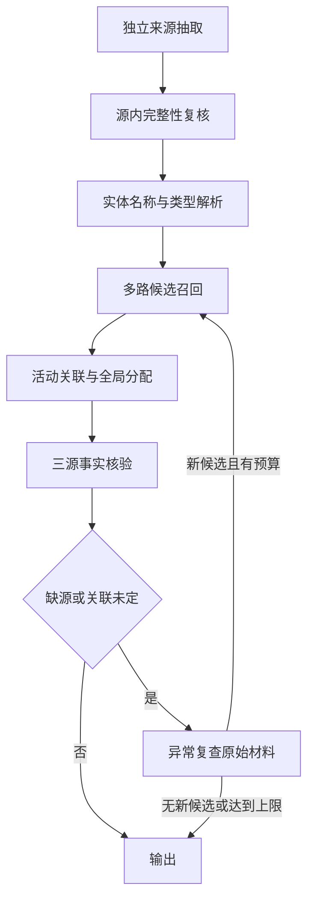

# 三源证据 Agent 工作流 v1

本版在原有独立来源抽取、关联审查和事实核验基础上，加入源内完整性复核、实体解析、多路候选召回与异常复查。流程由状态控制器协调，专业 Agent 之间传递结构化证据；新闻主组和原始材料一一归属约束由程序执行。

| 阶段 | 职责 | 输出与约束 |
| --- | --- | --- |
| 来源抽取 | 各自读取新闻、舆论，整理雷达活动 | 保留模型值、原文引用和雷达行；不跨源补事实 |
| 源内复核 | 检查缺失国家、平台、海域，及原文额外国家提及 | 只读本篇原文补带引用的值，不根据装备常识改国籍；引用与值在格式和代码两层约束 |
| 实体解析 | 引用明确时规范名称及平台类型；简称有歧义时调用模型 | 保存实体记录与转换依据，舰名与舰级不合并 |
| 候选召回 | 对全日材料索引；结合结构化实体、原文主体、时间、地点、任务 | 检索提议只用于进入审查，不表示同活动或可信 |
| 活动关联 | 模型阅读原文和候选雷达 | 同活动、不同活动、不确定，保留每条引用 |
| 全局分配 | 在已审查候选之间重新分配 | 材料不重复占用；复查增加候选时保留旧审查结果 |
| 事实核验 | 三源逐字段核验，程序检查引用和显式数值 | 缺失保持未知；真实冲突不由多数票消除 |
| 异常复查 | 对缺源或关联未定事件读取此前未审查的原始材料 | 提议的新候选仍进入独立关联审查和事实核验；每轮上限与覆盖范围记录 |
| 输出 | 分别记录关联、事实、来源覆盖 | 外部仍为可信／不可信两类；预算不足不等于原始材料不存在 |



`workflow.enabled` 开启工作流。最多进行 `max_recovery_rounds` 轮新增证据复查；每个缺源事件每轮读取最多 `recovery_batch_size` 个原始候选，并提议最多 `max_recovered_candidates` 个候选。复查不是来源不存在的证明；未检查材料及停止原因会保存。

正常运行可复用已有模型响应，但新候选必须经过真实模型审查。工作流 v1 执行源内复核、实体解析、候选召回、关联、全局分配、核验与检索回流；抽取引用错误由现有校验重试处理。同一轮内或回流后证据、所选关联及阻断条件未变时，复用已通过核验的结论；证据改变时重新核验，避免无新证据反复抽样改变结论。它没有实现任意动态任务委派，也不会自动改写原始材料。

v1 的异常复查读取此前未审阅的候选，保留已有关联审查结论；它不重新裁决所有已被模型否决的配对。源内复核针对缺失核心字段及额外国家提及，不保证每项事实都被抽取，也不重新审查每项已选任务的语义角色。引用校验能检查值是否有原文依据，不能证明抽取完整或所有角色判断都正确。

源内复核和独立排除角色审查使用统一字段定义。country 是行动主体国籍，direction 是赛题海区分类，不是航向。拟排除的事实由独立请求只看自身原文审查，当前主体国籍不可用“背景属性”角色排除，明确事实和角色未定均保留。不同 Agent 使用相同本地模型，仍可能产生相关语义错误，流程审计及真值评测不可省略。

完整运行（包含重新抽取），在仓库根目录执行：

```powershell
& D:\APP\miniconda\envs\multimodal-agent\python.exe -m fusion_agent run --date 2025-05-01 --single-day --use-llm --strict-llm --agent-workflow --max-llm-calls 600 --force --output-dir Code\outputs\agent_workflow_full_20250501
```

`--no-agent-workflow` 可运行原有顺序流程进行对照。离线规则模式保持原流程。

本次对照试验从 `agent_workflow_20250501/baseline.json` 中的原正式抽取结果出发。脚本先将每条原文引用和雷达行与源文件核对，再让本地模型执行新工作流，源内复核可补回遗漏核心字段。这减少整日重新抽取的随机变化，是工作流真实推理试验；整日材料没有重新抽取。`manifest.json` 的 `input_mode` 为 `saved_validated_extraction`。

```powershell
& D:\APP\miniconda\envs\multimodal-agent\python.exe Code\scripts\run_workflow_trial.py
& D:\APP\miniconda\envs\multimodal-agent\python.exe Code\scripts\validate_one_to_one.py --analysis-dir Code\outputs\agent_workflow_20250501 --review-dir Code\outputs\agent_workflow_20250501\review --date 2025-05-01
& D:\APP\miniconda\envs\multimodal-agent\python.exe Code\scripts\summarize_workflow.py --analysis-dir Code\outputs\agent_workflow_20250501
```

状态迁移、每轮分组结果与复查引用保存在日 JSON 的 `trace`；每组 `assignment.workflow` 记录候选检索路径和回流；`semantic_review.workflow_diagnostics` 分别记录事实、关联、来源与搜索覆盖。

试验输出独立存放于 `Code/outputs/agent_workflow_20250501`，不自动替换正式阅读目录。对照脚本 `scripts/summarize_workflow.py` 读取原正式结果快照和试验结果，不调用模型。
